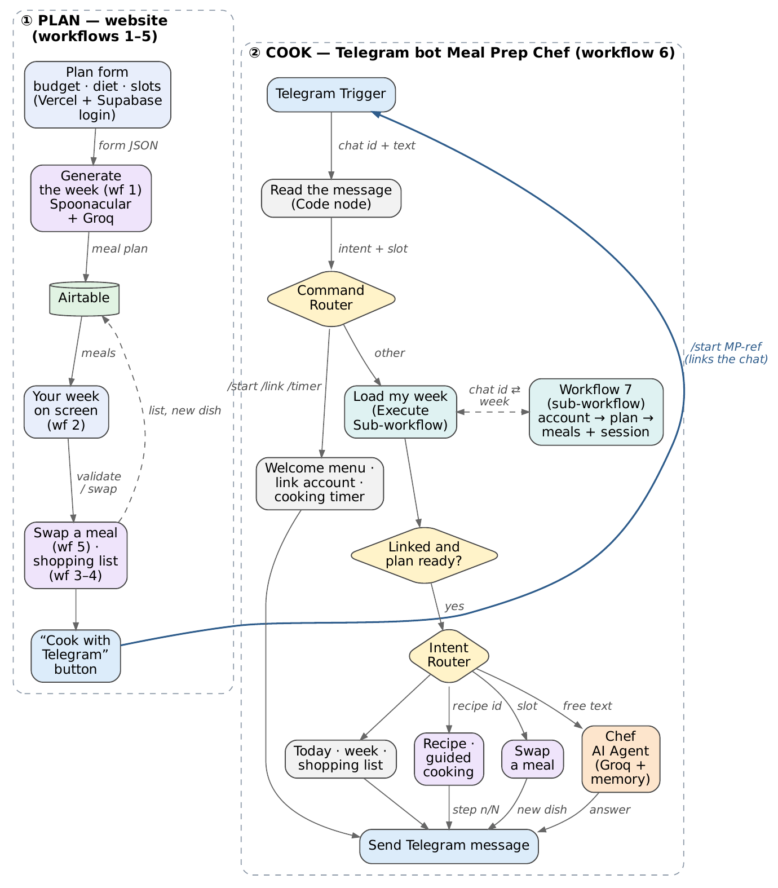
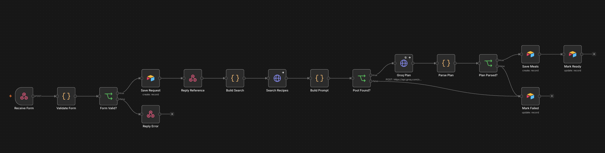
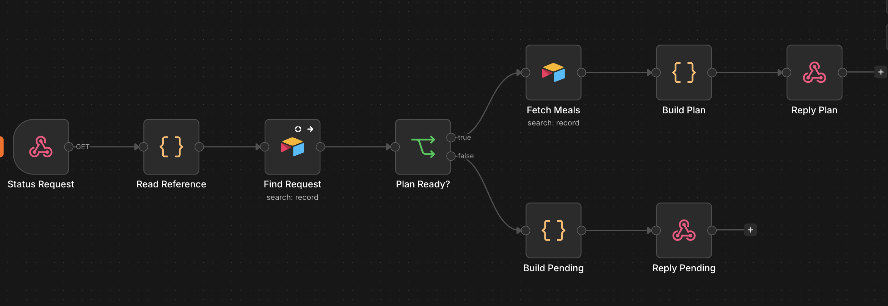
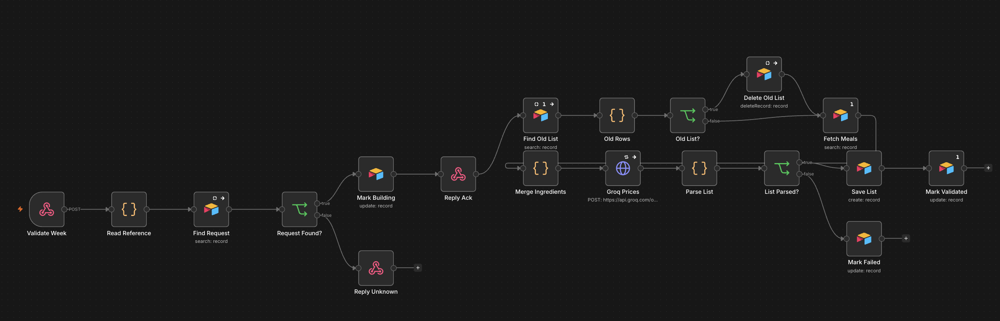
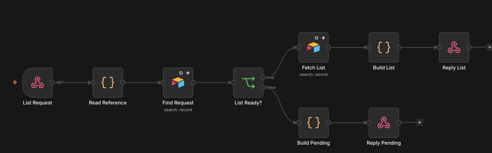
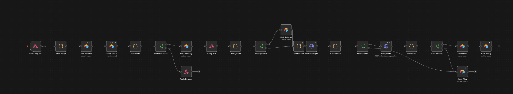
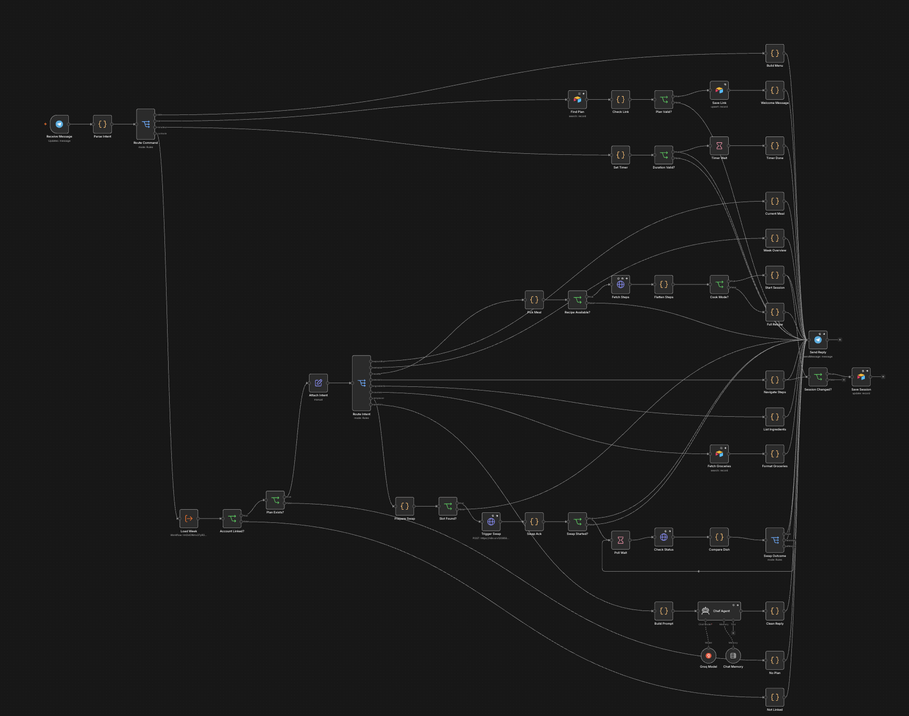
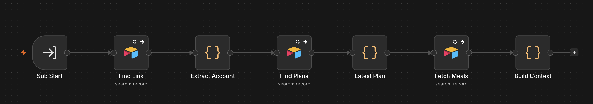

# Meal Prep 🍳

**Plan your week on the website, then cook it with a Telegram bot.**

This is my final project for the **No Code Software Development** course with **Benjamin Dallard** (BSc AIDAMS, ESSEC × CentraleSupélec). I'm aiming for **Level 3**.

- Website: https://meal-prep-intake-1.vercel.app
- Telegram bot: [@meal_prep_intake_bot](https://t.me/meal_prep_intake_bot)
- Project proposal (PDF): [docs/meal-prep-proposal.pdf](docs/meal-prep-proposal.pdf)

## Why I built it

When you cook on a budget, you lose a lot of time every week: picking recipes, checking what they cost, writing a shopping list, and then cooking with ten browser tabs open and a timer on your phone.

So I split the job in two:

1. **Plan** on the website. You enter your budget, how many people you're cooking for, your diet, what's already in your cupboard and which lunches and dinners you want to cook. You get a full week of recipes that fits the budget, plus one shopping list sorted by aisle.
2. **Cook** with the Telegram bot, *Meal Prep Chef*. It tells you what's on tonight, walks you through the recipe one step at a time, sets timers, lets you swap a meal, and answers any cooking question ("how do I know the chicken is done?").

## How it works



Everything runs on **7 n8n workflows** on my own n8n server. **Airtable** is the shared memory between the website and the bot.

| What | Tool | Used for |
|---|---|---|
| Website | Vercel (plain HTML + JS) | The form, the plan, swapping meals, the shopping list |
| Login | Supabase | Accounts, saved preferences, past plans |
| Automation | n8n (self-hosted on a Hostinger VPS) | All the logic: the 7 workflows below |
| Database | Airtable | Requests, meals, shopping lists, Telegram links and cooking sessions |
| Recipes | Spoonacular API | Recipe search, ingredients, nutrition, steps |
| AI | Groq (`openai/gpt-oss-120b`) | Picks the week's recipes, prices the shopping list, powers the Chef bot |
| Chat | Telegram | The cooking bot |

## The 7 workflows

### Part 1: plan on the website (workflows 1 to 5)

| # | File | Starts when… | What it does |
|---|---|---|---|
| 1 | `01-generate-plan.json` | The site sends the form | Checks the form, saves it, and sends a plan reference back straight away. Then it finds about 30 recipes on Spoonacular, drops the ones that need equipment you don't have, and asks Groq to pick one recipe per meal within the budget. Code checks Groq's answer before every meal is saved. It also handles leftovers: a dinner can be cooked in double and become the next day's lunch. |
| 2 | `02-plan-status.json` | The site asks "is my plan ready?" | Sends back the finished plan, "still working", or the reason it failed. |
| 3 | `03-build-shopping-list.json` | You confirm your week | Merges all the ingredients into one list **in code**: "tomatoes" and "fresh tomato" become one line, and units are converted so each item shows a single quantity. Groq only adds the aisle, an estimated price, and whether you already have it. |
| 4 | `04-read-shopping-list.json` | The site asks for the list | Sends the shopping list back to the site. |
| 5 | `05-swap-meals.json` | You reject some meals | Finds new recipes for those slots, never one you've already seen, while keeping the rest of the week in mind. |

### Part 2: cook with the Telegram bot (workflows 6 and 7)

| # | File | Starts when… | What it does |
|---|---|---|---|
| 6 | `06-telegram-chef.json` | You send the bot a message | Works out what you want and which meal you mean (Paris time), then handles it: `/today`, `/week`, `/recipe`, `/cook` (step by step with `next`, `back` and `repeat`), `/timer 10`, `/list`, `/swap`, and linking your account with `/start MP-…`. Anything else goes to an AI agent that remembers the last 10 messages. |
| 7 | `07-load-week.json` | Workflow 6 calls it | Sub-workflow: goes from your Telegram chat to your account, your latest plan, its meals and where you are in a recipe. |

## Screenshots of the workflows

**1. Generate the plan**


**2. Plan status**


**3. Build the shopping list**


**4. Read the shopping list**


**5. Swap meals**


**6. Meal Prep Chef (Telegram bot)**


**7. Load the week (sub-workflow)**


## Course requirements

| Requirement | Where to find it |
|---|---|
| Trigger | Webhooks (1 to 5), Telegram message trigger (6), sub-workflow trigger (7) |
| Router | `Route Command` and `Route Intent` Switch nodes in 6, plus IF nodes everywhere |
| Code node | Checking the form, building the prompts, reading Groq's answers, merging ingredients (1, 3, 5), understanding messages (6) |
| API | Spoonacular and Groq |
| Database | Airtable, 4 tables |
| AI node | `Chef Agent` with the Groq model and chat memory (6); Groq over HTTP for structured JSON (1, 3, 5) |
| Sub-workflow | 6 calls 7 (`Load Week`) |
| Error handling | When something fails, the reason is saved and shown on the site; API nodes retry and keep going; if Groq gives a bad answer, the workflow falls back to other recipes |

## Run it yourself

1. In n8n, create the credentials listed in `.env.example` (Airtable, Groq, Telegram).
2. Import the 7 files from `workflows/`. Import **7 before 6**, then pick it again in the `Load Week` node of workflow 6.
3. Replace `YOUR_SPOONACULAR_API_KEY` (workflows 1, 5 and 6) and `YOUR_N8N_HOST` (workflow 6) with your own values.
4. Connect each Airtable, Groq and Telegram node to your credentials, then activate the workflows.
5. Website: `frontend/` is a single HTML page with no build step. In `index.html`, put your n8n webhook URL and your Supabase URL and publishable key, then deploy the folder to Vercel (`vercel --prod` from inside `frontend/`).

## What's in this repo

```
workflows/   the 7 n8n workflows (API key removed)
frontend/    the website, as it's deployed on Vercel
docs/        the architecture diagram, my project proposal and screenshots of each workflow
.env.example the keys you need to run it
```

## Limits and next steps

- Groq's free plan allows 30 requests a minute and 1,000 a day, which caps how many plans can be generated.
- Spoonacular's free plan limits how many recipe searches I can do per day.
- Prices are estimates from the AI, not real supermarket prices.
- Next, I want to redesign the website.
